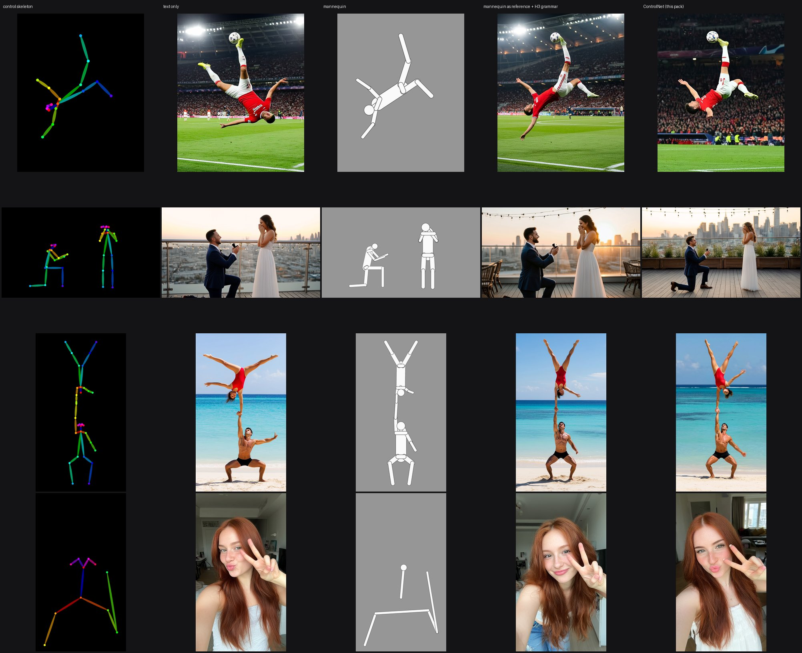
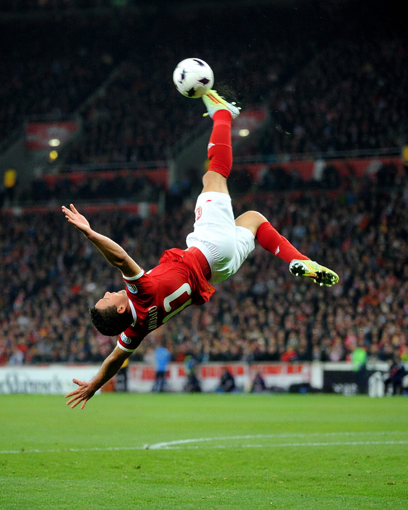
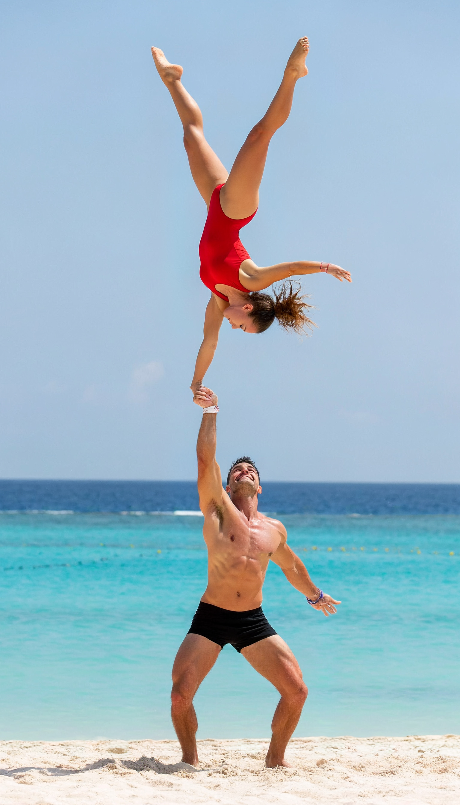
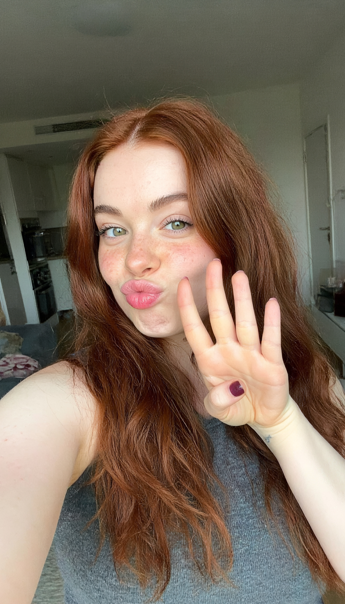
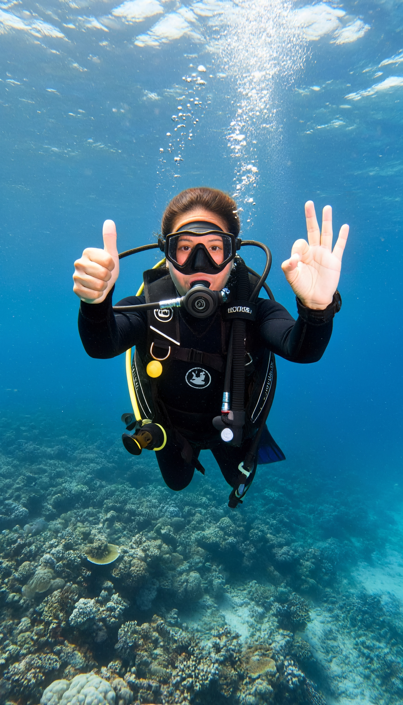
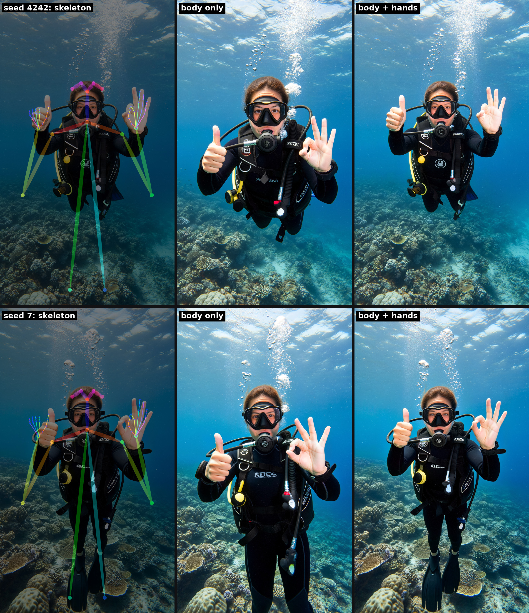
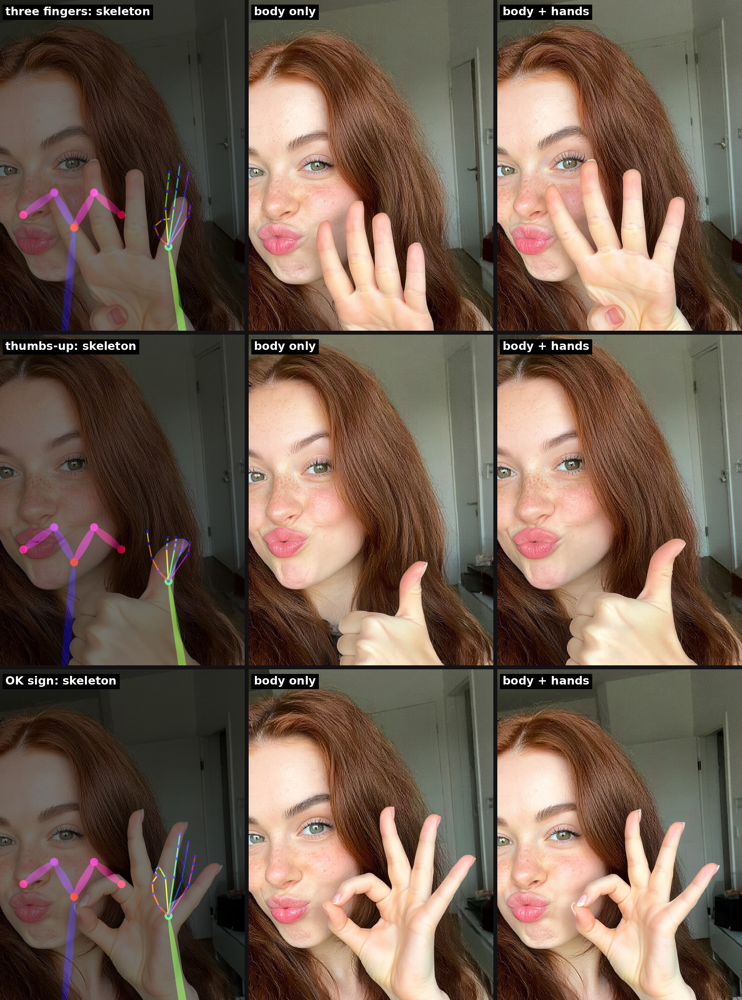
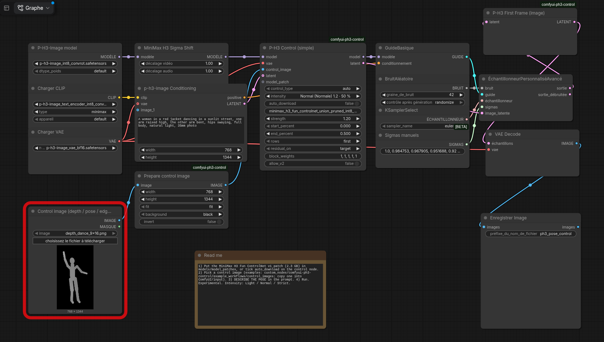

# P-H3 Control

Nœuds ComfyUI qui font piloter le modèle d'image **P-H3-Image** par le ControlNet officiel MiniMax H3 Fun (pose, profondeur, contours).

> ⚠️ **Expérimental — aperçu de recherche.** Testé seulement sur nos propres bancs, l'API peut changer, les poses
> extrêmes ne sont suivies que partiellement. Les squelettes de mains placent les mains ; le geste vient du prompt. Projet communautaire, pas officiel MiniMax ni PrunaAI.
> English version: [README.md](README.md)



*Même graine, quatre scènes. Colonnes : squelette de contrôle, texte seul, image de mannequin, mannequin en référence avec la
grammaire de prompt officielle H3, ControlNet (ce pack). Détails et chiffres : [docs/COMPARISON.md](docs/COMPARISON.md).*

## Pourquoi un ControlNet ?

Un squelette donné à P-H3 comme simple image de référence marche mal (3 poses justes sur 9 dans nos tests). Une référence dit
au modèle *quoi* montrer, pas *où* : elle est lue globalement, sans lien pixel à pixel avec l'image produite. Et un squelette OpenPose
est un code couleur que le modèle n'a jamais appris : il recopie les bâtons colorés ou les ignore. Le ControlNet a été entraîné sur
des paires squelette / photo et injecte la pose au bon endroit, dans le modèle, pendant la première moitié des pas.
Précision de pose (PCK@0,1) : **0,435** texte seul, **0,815** avec ce pack. Un mannequin blanc en référence fait mieux qu'un squelette
(6 poses courantes sur 6) mais reste approximatif sur la position exacte ; voir [docs/COMPARISON.md](docs/COMPARISON.md).

## Galerie (4 Mpx, générées directement)

Contrôle appliqué directement à ~4 Mpx (1536x2688), sans passe d'agrandissement. Cliquer pour la taille réelle.

| | |
|---|---|
|  |  |
|  |  |
|  | |

Originaux PNG sans perte joints à la [release v0.4.0-experimental](https://github.com/RubenTorney/comfyui-ph3-control/releases/tag/v0.4.0-experimental).

Pourquoi 4 Mpx : générer à 1 Mpx puis refaire l'image à 16 Mpx recopie les défauts de la petite image (peau cireuse, taches
de rousseur en pâté) ; un contrôle direct à 8 Mpx laisse dériver la pose. Le 4 Mpx direct garde la pose et une peau naturelle.

## Mains

Ajouter au squelette du corps les squelettes de mains à 21 points (format DWPose / OpenPose), **et nommer le geste dans le prompt**.



*Deux mains sur une même photo (droite : pouce levé, gauche : OK), deux graines. Avec les points des mains, les mains tombent
exactement là où le squelette les place ; avec le corps seul, le modèle les rapproche du visage. Les gestes sont justes dans les quatre.*



*Pouce levé et OK : justes avec ou sans points de mains. « Trois doigts » : quatre doigts à chaque fois, même avec le contrôle
tenu sur 75 % ou 100 % des pas ([hands_strict.jpg](assets/demo/hands_strict.jpg)). Le squelette de main fixe la position et la taille,
pas le nombre de doigts levés.*

Pour obtenir des squelettes de mains : les extraire d'une photo de soi faisant le geste (DWPose dans
[comfyui_controlnet_aux](https://github.com/Fannovel16/comfyui_controlnet_aux)), ou les poser dans un éditeur OpenPose 3D.
Exemple : `example_workflows/control_images/pose_hands_diver_9x16.png`.

## Installation

```
cd ComfyUI/custom_nodes && git clone https://github.com/RubenTorney/comfyui-ph3-control
```
ComfyUI >= 0.44, aucun pip install. Redémarrer ComfyUI. Télécharger le patch v1
`minimax_h3_fun_controlnet_union_pruned_int8_convrot.safetensors` (2,3 Go, [Comfy-Org/MiniMax-H3](https://huggingface.co/Comfy-Org/MiniMax-H3),
dossier `model_patches/`) dans `models/model_patches/` (ou cocher `auto_download` sur le nœud), et les fichiers P-H3-Image depuis
[PrunaAI/P-H3-Image-Comfy](https://huggingface.co/PrunaAI/P-H3-Image-Comfy). Aucun poids n'est inclus.

**Modèles utilisés** (liens) :
- [MiniMaxAI/MiniMax-H3](https://huggingface.co/MiniMaxAI/MiniMax-H3) — le modèle MiniMax H3 d'origine et sa licence.
- [PrunaAI/P-H3-Image](https://huggingface.co/PrunaAI/P-H3-Image) · fichiers ComfyUI : [PrunaAI/P-H3-Image-Comfy](https://huggingface.co/PrunaAI/P-H3-Image-Comfy) — le modèle d'image piloté par ce pack.
- [alibaba-pai/MiniMax-H3-Fun-Controlnet-Union](https://huggingface.co/alibaba-pai/MiniMax-H3-Fun-Controlnet-Union) — le Fun ControlNet (v1) · fichier ComfyUI : [Comfy-Org/MiniMax-H3](https://huggingface.co/Comfy-Org/MiniMax-H3/tree/main/model_patches).
- Guide officiel d'écriture des prompts : [MiniMax-AI/MiniMax-H3-Image — h3-image-prompt-writing](https://github.com/MiniMax-AI/MiniMax-H3-Image/tree/main/skills/h3-image-prompt-writing).

## Compatibilité

| Modèle | État |
|---|---|
| **P-H3-Image `int8_convrot`** ([PrunaAI/P-H3-Image-Comfy](https://huggingface.co/PrunaAI/P-H3-Image-Comfy)) | **Testé** : tous les résultats et chiffres de ce dépôt |
| P-H3-Image `bf16`, `w4a8`, versions GGUF de la communauté | Non testé. Même architecture et mêmes nœuds, donc devrait fonctionner ; qualité et VRAM peuvent varier |
| **MiniMax H3 Image** de base ([MiniMaxAI](https://huggingface.co/MiniMaxAI/MiniMax-H3-Image) / [Comfy-Org](https://huggingface.co/Comfy-Org/MiniMax-H3-Image)), ses fine-tunes et distillations en peu de pas | Non testé. Les réglages (8 pas, force, table adaLN) ont été mis au point sur P-H3-Image uniquement |
| Modèles vidéo MiniMax H3 | Hors du pack : utiliser le nœud `MiniMaxH3FunControlNetApply` de ComfyUI |

Les retours sur d'autres versions sont bienvenus (ouvrir une issue avec le fichier du modèle et un exemple).

## Utilisation



*`example_workflows/ph3_pose_control_basic.json` — copiez d'abord une image de contrôle dans `ComfyUI/input` (le cadre rouge signale qu'elle manque)..*


1. Glisser `example_workflows/ph3_pose_control_basic.json` dans ComfyUI.
2. Charger une image de contrôle (profondeur, squelette OpenPose ou contours ; exemples dans `example_workflows/control_images/`, à copier dans `ComfyUI/input`), ou rendre un pantin 3D depuis une pose JSON avec le nœud **P-H3 Puppet render**.
3. **Décrire la pose dans le prompt** : le contrôle guide, il ne remplace pas le texte.
4. Choisir l'intensité sur **P-H3 Control (simple)** et lancer (environ 16 s en 768x1344, un brouillon rapide).
5. Qualité finale : `ph3_pose_control_4mp_hands.json` (contrôle direct en 1536x2688, squelettes de mains, environ 45 s sur une RTX 3090).
   Sans ControlNet : `ph3_mannequin_reference.json`. Éviter « photorealistic, sharp detail » dans le prompt ; décrire une photo naturelle, non retouchée.

| Intensité | Force · pas contrôlés | PCK@0,1 | Netteté |
|---|---|---|---|
| Légère | 1,2 · 25 % premiers | 0,79 | 1,06 |
| **Normale** (défaut) | 1,2 · 50 % premiers | **0,815** | **1,15** |
| Stricte | 1,2 · 75 % premiers | 0,815 | 1,06 |

Stricte si la pose dérive, Légère si l'image paraît raide. (Sans contrôle : 0,435 / 1,00.)

## Limites

- Utiliser le patch **v1** ; le v2 est refusé (mesuré : aucun contrôle).
- Le contrôle exige le latent à 2 trames du nœud et **P-H3 First Frame** avant le décodage VAE (les workflows le font) ; sur un latent à 1 trame, il échoue et l'image se dégrade.
- Meilleure qualité à ~4 Mpx direct (1536x2688). Pas 8 Mpx (la pose dérive), pas 1 Mpx + agrandissement (peau cireuse). Mémoire insuffisante : réduire la résolution. Pose non suivie : la décrire, ou passer en Stricte.
- Poses extrêmes / vues de dessus suivies partiellement. Les points des mains placent les mains ; le nombre de doigts levés suit le prompt, pas le squelette. Environ 21 Go de VRAM pour P-H3-Image.

## Tests

```
COMFYUI_PATH=/chemin/vers/ComfyUI python -I tests/run_tests.py     # Python de ComfyUI, sans GPU
```

## Licence et crédits

Code : MIT (`LICENSE`). Aucun poids redistribué ; MiniMax H3, le patch et P-H3-Image sont sous la **MiniMax H3 Community License**
(`NOTICE`, `third_party/`), avec des restrictions territoriales (UE, Royaume-Uni, Corée du Sud, États-Unis) : vérifiez que vous pouvez les utiliser.
La petite table adaLN de `ph3_control/data/` relève de cette licence, pas de MIT ; `scripts/build_release.sh --no-table` produit un pack
sans elle (voir `NOTICE`). Powered by MiniMax H3. Crédits : MiniMax, alibaba-pai (VideoX-Fun), Comfy-Org, PrunaAI. Images de démo générées par IA.
