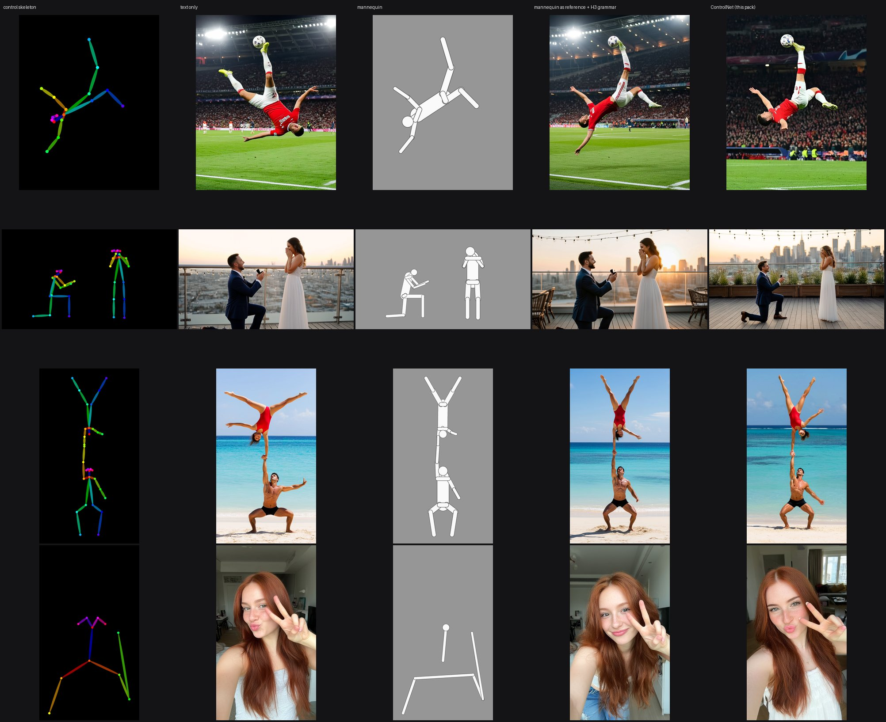
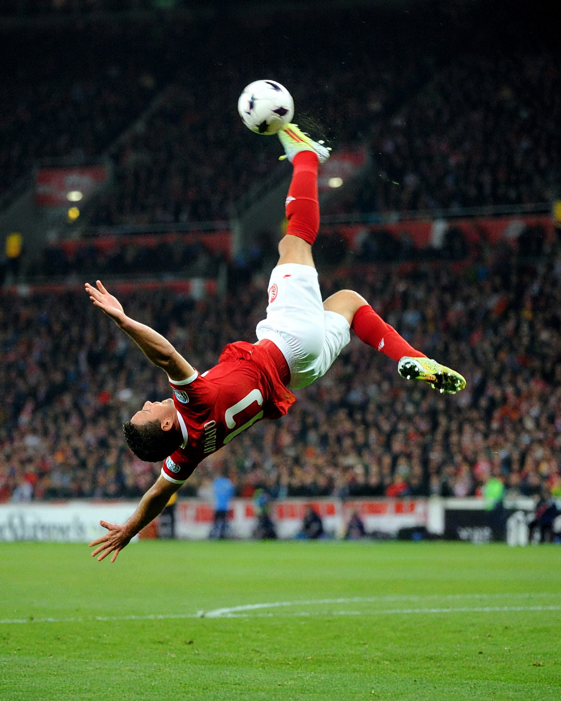
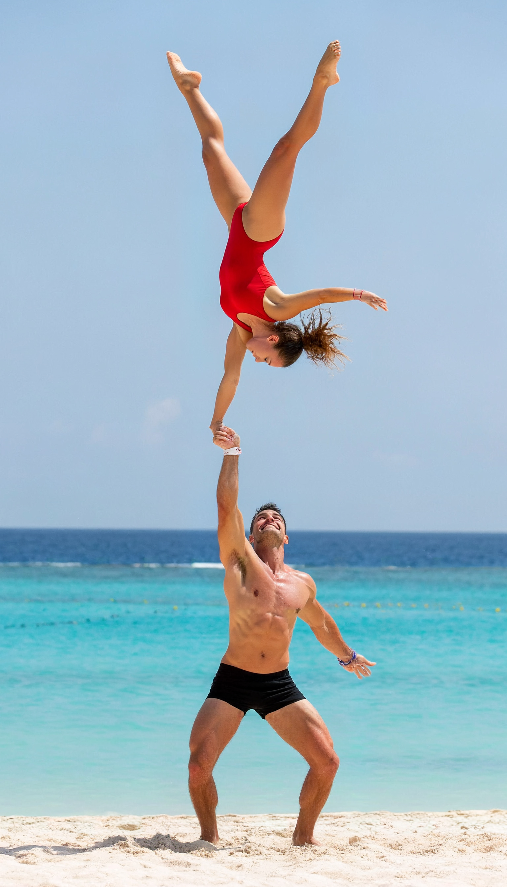
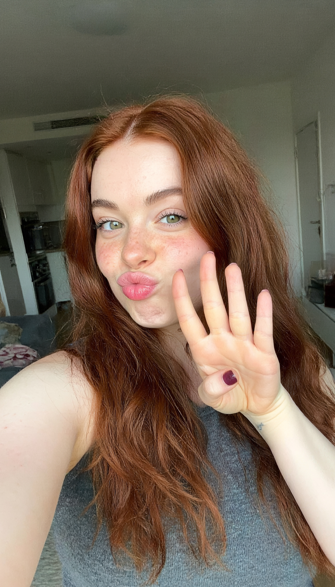
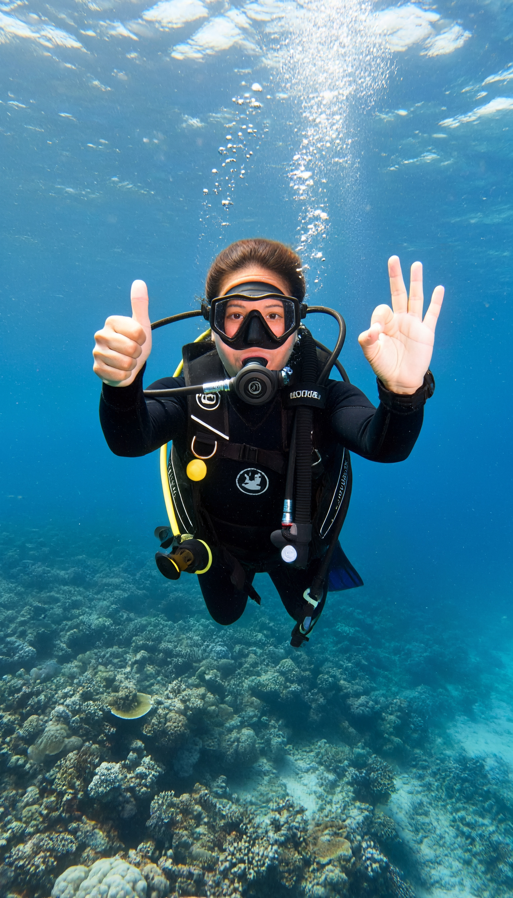
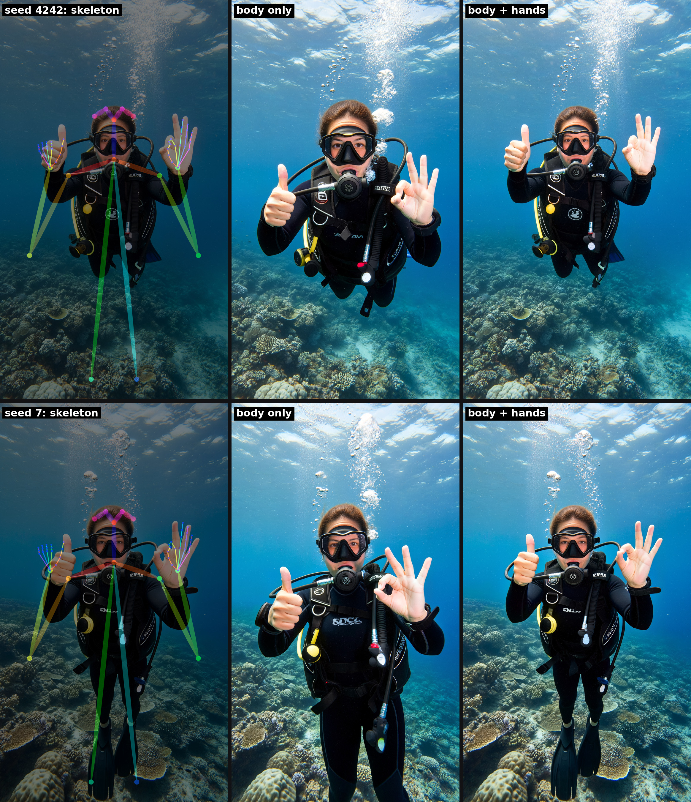
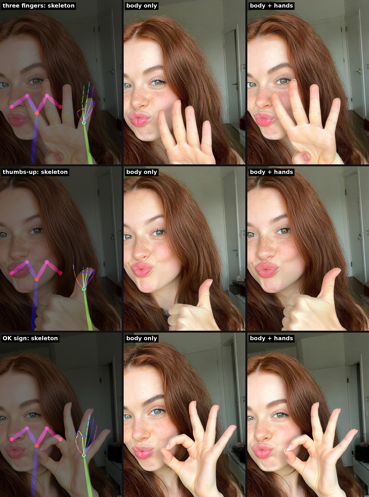
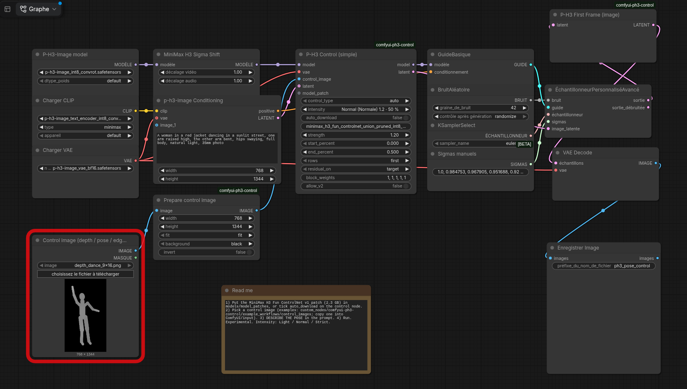

# P-H3 Control

ComfyUI nodes that let the official MiniMax H3 Fun ControlNet (pose, depth, edges) drive the **P-H3-Image** still-image model.

> ⚠️ **Experimental — research preview.** Only tested on our own benchmarks, the API may change, extreme poses are only
> partly followed. Hand skeletons place the hands; the gesture itself comes from the prompt. Not an official MiniMax or PrunaAI project.
> French version: [README.fr.md](README.fr.md)



*Same seed, four scenes. Columns: control skeleton, text only, mannequin image, mannequin as reference with the official
H3 prompt grammar, ControlNet (this pack). Details and numbers: [docs/COMPARISON.md](docs/COMPARISON.md).*

## Why a ControlNet?

A skeleton given to P-H3 as a plain reference image works poorly (3 of 9 poses right in our tests). A reference tells the model
*what* to show, not *where*: it is read as a whole, with no pixel-to-pixel link to the output. And an OpenPose skeleton is a
colour code the model never learned, so it either copies the coloured sticks or ignores them. The ControlNet was trained on
skeleton / photo pairs and injects the pose at the right place inside the model during the first half of the steps.
Pose accuracy (PCK@0.1): **0.435** text only, **0.815** with this pack. A white mannequin as reference does better than a
skeleton (6 of 6 common poses) but stays approximate on the exact position; see [docs/COMPARISON.md](docs/COMPARISON.md).

## Gallery (4 MP, generated directly)

Control applied directly at ~4 MP (1536x2688), no upscaling pass. Click for full size.

| | |
|---|---|
|  |  |
|  |  |
|  | |

Lossless PNG originals are attached to the [v0.4.0-experimental release](https://github.com/RubenTorney/comfyui-ph3-control/releases/tag/v0.4.0-experimental).

Why 4 MP: generating at 1 MP and re-rendering at 16 MP copies the small image's flaws (waxy skin, blotchy freckles);
a direct 8 MP control lets the pose drift. 4 MP direct keeps both the pose and a natural skin.

## Hands

Add the 21-point hand skeletons (DWPose / OpenPose format) to the body skeleton, **and name the gesture in the prompt**.



*Two hands on one photo (right: thumbs-up, left: OK), two seeds. With the hand points, the hands land exactly where the
skeleton puts them; with the body only, the model moves them closer to the face. The gestures are right in all four.*



*Thumbs-up and OK: right with or without hand points. "Three fingers": four fingers every time, even with the control
held to 75 % or 100 % of the steps ([hands_strict.jpg](assets/demo/hands_strict.jpg)). The hand skeleton sets position and size,
not the number of raised fingers.*

To get hand skeletons: extract them from a photo of yourself doing the gesture (DWPose in
[comfyui_controlnet_aux](https://github.com/Fannovel16/comfyui_controlnet_aux)), or pose them in a 3D OpenPose editor.
Sample: `example_workflows/control_images/pose_hands_diver_9x16.png`.

## Install

```
cd ComfyUI/custom_nodes && git clone https://github.com/RubenTorney/comfyui-ph3-control
```
Needs ComfyUI >= 0.44, no pip install. Restart ComfyUI. Download the v1 patch
`minimax_h3_fun_controlnet_union_pruned_int8_convrot.safetensors` (2.3 GB, from
[Comfy-Org/MiniMax-H3](https://huggingface.co/Comfy-Org/MiniMax-H3) `model_patches/`) into `models/model_patches/`
(or tick `auto_download` on the node), and the P-H3-Image files from
[PrunaAI/P-H3-Image-Comfy](https://huggingface.co/PrunaAI/P-H3-Image-Comfy). Weights are not included.

**Models used** (links):
- [MiniMaxAI/MiniMax-H3](https://huggingface.co/MiniMaxAI/MiniMax-H3) — the original MiniMax H3 model and its license.
- [PrunaAI/P-H3-Image](https://huggingface.co/PrunaAI/P-H3-Image) · ComfyUI files: [PrunaAI/P-H3-Image-Comfy](https://huggingface.co/PrunaAI/P-H3-Image-Comfy) — the image model driven by this pack.
- [alibaba-pai/MiniMax-H3-Fun-Controlnet-Union](https://huggingface.co/alibaba-pai/MiniMax-H3-Fun-Controlnet-Union) — the Fun ControlNet (v1) · ComfyUI file: [Comfy-Org/MiniMax-H3](https://huggingface.co/Comfy-Org/MiniMax-H3/tree/main/model_patches).
- Official prompt guide: [MiniMax-AI/MiniMax-H3-Image — h3-image-prompt-writing](https://github.com/MiniMax-AI/MiniMax-H3-Image/tree/main/skills/h3-image-prompt-writing).

## Use it



*`example_workflows/ph3_pose_control_basic.json` — copy a control image into `ComfyUI/input` first (the red frame means it is missing).*


1. Drag `example_workflows/ph3_pose_control_basic.json` into ComfyUI.
2. Load a control image (depth map, OpenPose skeleton or edges; samples in `example_workflows/control_images/`, copy one into `ComfyUI/input`), or render a 3D puppet from a JSON pose with the **P-H3 Puppet render** node.
3. **Describe the pose in the prompt**: the control guides, it does not replace the text.
4. Pick an intensity on **P-H3 Control (simple)** and run (about 16 s at 768x1344, a quick draft).
5. Final quality: `ph3_pose_control_4mp_hands.json` (control directly at 1536x2688, hand skeletons, about 45 s on an RTX 3090).
   Without ControlNet: `ph3_mannequin_reference.json`. Avoid "photorealistic, sharp detail" in the prompt; describe a natural, unretouched photo.

| Intensity | Strength · steps controlled | PCK@0.1 | Sharpness |
|---|---|---|---|
| Light | 1.2 · first 25 % | 0.79 | 1.06 |
| **Normal** (default) | 1.2 · first 50 % | **0.815** | **1.15** |
| Strict | 1.2 · first 75 % | 0.815 | 1.06 |

Strict if the pose drifts, Light if the picture looks stiff. (No control: 0.435 / 1.00.)

## Limits

- Use the **v1** patch. The v2 patch is refused (measured: no control).
- The control needs the 2-frame latent from the control node and **P-H3 First Frame** before the VAE decode (the example workflows do it); on a 1-frame latent it fails and the image degrades.
- Best quality at ~4 MP directly (1536x2688). Not 8 MP (the pose drifts), not 1 MP + an upscaling pass (waxy skin). Out of memory: lower the resolution. Pose not followed: describe it, or use Strict.
- Extreme / top-down poses are partly followed. Hand points place the hands; the number of raised fingers follows the prompt, not the skeleton. About 21 GB VRAM for P-H3-Image.

## Tests

```
COMFYUI_PATH=/path/to/ComfyUI python -I tests/run_tests.py     # use ComfyUI's Python, no GPU
```

## License and credits

Code: MIT (`LICENSE`). No weights are redistributed; MiniMax H3, the patch and P-H3-Image are under the **MiniMax H3 Community
License** (`NOTICE`, `third_party/`), which has territorial restrictions (EU, UK, South Korea, US) — check that you may use them.
The small adaLN table in `ph3_control/data/` falls under that license, not MIT; `scripts/build_release.sh --no-table` builds a pack
without it (see `NOTICE`). Powered by MiniMax H3. Credits: MiniMax, alibaba-pai (VideoX-Fun), Comfy-Org, PrunaAI. Demo images are AI-generated.
