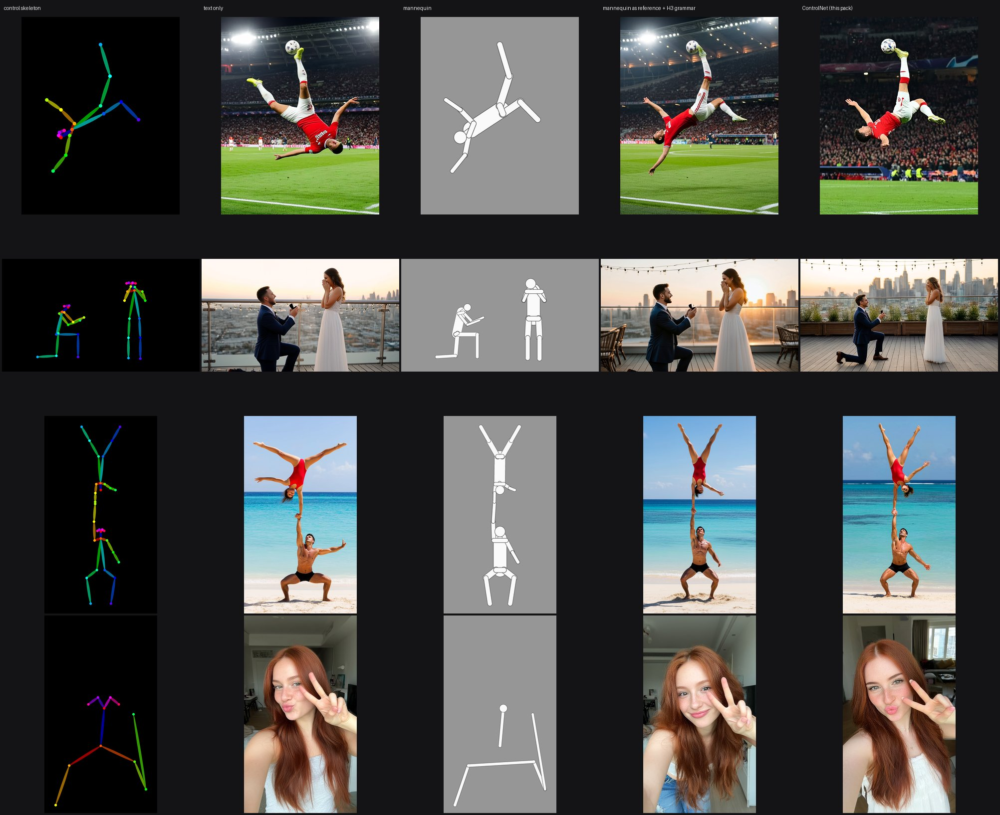

# How it compares / Comparaison des méthodes

English first, [version française plus bas](#comparaison-des-méthodes). All figures are our own measurements; the
pack is experimental.

## 1. Pose benchmark (ControlNet settings)

6 poses x 2 seeds, 768x1344, one reference character. **PCK@0.1** = share of body keypoints (measured with SDPose) within
10 % of the target pose. **Sharpness** is relative to the no-control image (1.00).

| Configuration | PCK@0.1 | Sharpness |
|---|---|---|
| Text only (no control) | 0.435 | 1.00 |
| Old naive control (1 frame, all rows, all steps) | 0.738 | 0.41 |
| **This pack: 2 frames, target only, first 50 % of steps, strength 1.2** | **0.815** | **1.15** |
| Same, first 25 % of steps | 0.792 | 1.06 |
| Same, first 75 % of steps | 0.815 | 1.06 |
| Strength 1.5 | 0.726 | |
| Decreasing per-block weights | about 0.44 (control lost) | |
| DWPose skeleton with feet | 0.792 | |
| Two passes (pose, then identity) | 0.72, identity lost | |
| v2.0 patch | about text only (not supported) | |
| ~1 MP then a 16 MP edit pass | pose kept, but waxy skin and blotchy freckles (the small image's flaws are copied) |
| **4 MP directly** (1536x2688) | **pose kept, natural skin: the recommended final setting** |
| 8 MP directly | pose drifts (e.g. a V sign instead of three fingers) | |

## 2. Methods without ControlNet (qualitative, on P-H3)

- **OpenPose skeleton as a reference image**: 3 of 9 poses right.
- **"Volume" guides as reference**: a white mannequin with grey outlines is the most reliable; a "line only" guide is sometimes copied as is.
- **Official MiniMax H3Image grammar** (`<Picture N>`, `<Subject N>`, preservation relations) with the mannequin as Picture 1: **6 of 6** common poses right.
- **Editing the guide** (mannequin as the base image): 6 of 6, with an occasional leftover texture.

## 3. Final A/B on four demo scenes (same seed)

| Method | Result |
|---|---|
| Text only | plausible pose, free composition |
| Mannequin as reference + H3 grammar | very close to the target, faster (about 11 s vs 16 s), no patch, works at 8 MP directly (less exact pose) |
| ControlNet (this pack) | most faithful to the geometry: limb angles, size and position of each person, several people |

None of them controls the number of raised fingers.

## 3b. Hands (21-point hand skeletons, 4 MP, same seed)

| Test | Body only | Body + hands |
|---|---|---|
| Selfie, thumbs-up | right | right |
| Selfie, OK sign | right | right |
| Selfie, three fingers | four fingers | four fingers (also with control on 75 % / 100 % of the steps) |
| Diver, thumbs-up + OK on two hands, 2 seeds | gestures right, hands moved toward the face | gestures right, **hands exactly where the skeleton puts them** |

Hand points set the position and size of the hands; the gesture follows the prompt. Images: `assets/demo/hands_*.jpg`.

## 4. When to use what

- **Most cases**: mannequin as Picture 1 + the official grammar (`ph3_mannequin_reference.json`). Simple, fast, no extra weights.
- **When the composition must be exact** (matching shots, several people placed precisely): this ControlNet (`ph3_pose_control_basic.json` for drafts, `ph3_pose_control_4mp_hands.json` for the final image).

## 5. Reference

| Node | Role |
|---|---|
| P-H3 Control (simple) | `model`, `vae`, `control_image`, `control_type`, `intensity` (Light / Normal / Strict / Custom); optional `latent`, `auto_download`, `model_patch`, `patch_name`, and for Custom: `strength`, `start_percent`, `end_percent` (fractions of the steps), `rows`, `residual_on`, `block_weights`, `allow_v2`. Outputs `model` and a 2-frame `latent` |
| P-H3 Control (advanced) | same with an explicit `model_patch` and `adaln_reference` |
| P-H3 Control Latent (2 frames) / P-H3 First Frame (image) | latent to 2 frames, and back to the first frame before the VAE decode |
| P-H3 Puppet render | pose JSON to control image (depth, shaded, edges, normal, mask), CPU, about 1 s |
| Edges (light Canny), Prepare control image | edge map; resize / pad / invert |

**Final quality recipe**: control directly at ~4 MP (1536x2688 for 9:16), Normal intensity, the 2-frame latent and P-H3 First Frame
as usual, a prompt that names the gestures and describes a natural, unretouched photo (no "photorealistic, sharp detail").

## Comparaison des méthodes

Toutes les valeurs viennent de nos mesures ; le pack est expérimental.

**Banc de pose** (6 poses x 2 graines, 768x1344, un personnage de référence, PCK@0,1 via SDPose, netteté relative au témoin) :
texte seul 0,435 / 1,00 ; ancien contrôle naïf 0,738 / 0,41 ; **ce pack (2 trames, cible seule, 50 % des pas, force 1,2) 0,815 / 1,15** ;
25 % des pas 0,792 / 1,06 ; 75 % 0,815 / 1,06 ; force 1,5 : 0,726 ; poids par bloc décroissants : environ 0,44 (contrôle perdu) ;
squelette DWPose avec pieds 0,792 ; deux passes (pose puis identité) 0,72 mais identité perdue ; patch v2.0 : comme le texte seul
(non supporté) ; 1 Mpx puis passe à 16 Mpx : peau cireuse ; **4 Mpx direct : pose tenue et peau naturelle (réglage final recommandé)** ;
8 Mpx direct : la pose dérive.

**Sans ControlNet** (qualitatif sur P-H3) : squelette OpenPose en référence, 3 poses justes sur 9 ; guides « en volumes » : le mannequin
blanc à traits gris est le plus fiable, le « trait seul » est parfois recopié tel quel ; grammaire officielle MiniMax H3Image
(`<Picture N>`, `<Subject N>`, relations de préservation) avec le mannequin en référence : **6/6** poses courantes justes ;
retouche du guide (mannequin = image de base) : 6/6 avec un résidu de texture ponctuel.

**A/B sur les 4 scènes de démo** (même graine, image ci-dessus) : texte seul = pose plausible, composition libre ; mannequin en
référence = très proche, plus rapide (~11 s contre ~16 s), sans patch, 8 Mpx direct possible (pose moins exacte) ; ControlNet = le plus fidèle à la géométrie
(angles, taille et position de chaque personne, plusieurs personnes). Aucun ne contrôle le nombre de doigts levés.

**Mains** (squelettes à 21 points, 4 Mpx, même graine) : pouce levé et OK justes avec ou sans points de mains ; « trois doigts » donne
quatre doigts dans tous les cas, même avec le contrôle sur 75 % ou 100 % des pas ; plongeuse avec pouce levé + OK sur deux mains,
deux graines : gestes justes partout, et avec les points des mains, les mains tombent exactement à l'endroit du squelette. Les points
fixent la position et la taille des mains, le geste suit le prompt.

**Quand utiliser quoi** : mannequin + grammaire officielle pour la plupart des cas ; ce ControlNet quand la composition doit être
exacte (raccords entre plans, plusieurs personnes placées).
